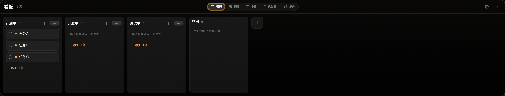

# WorkPanel

A keyboard-first task panel for macOS. Capture work in one line, then look at it through whichever lens fits the moment — Kanban, Eisenhower matrix, today's commitments, priority, or review.

<p align="center">
  
</p>

<p align="center">
  <a href="README_CN.md">中文文档</a>
</p>

## Features

### 5 Board Lenses

The board is one set of tasks shown five ways. Switch lenses from the tab bar at the top of the floating board panel.

| Lens | Description |
|------|-------------|
| **Kanban** (看板) | Custom columns with drag-and-drop between them; cards carry priority, deadline, and tags |
| **Matrix** (象限) | Eisenhower urgent × important quadrants — important = priority ≥ medium, urgent = within 48h of deadline (or a manual override) |
| **Today** (今日) | The day's committed tasks — pick what you'll actually push on today, separate from the full backlog |
| **Priority** (优先级) | Flat list grouped by high / medium / low priority |
| **Review** (复盘) | Completed-task retrospective for closing out the day |

### One-Line Quick Capture

Summon the capture panel with a hotkey and type the whole task on one line. The parser pulls structured fields out of plain text:

| Token | Meaning | Examples |
|-------|---------|----------|
| `#tag` | Tag | `#工作` `#家庭` |
| `!高` `!中` `!低` / `!1` `!2` `!3` | Priority | `!高` |
| `!紧急` `!不紧急` | Urgency override | `!紧急` |
| Relative day | Deadline date | `今天` `明天` `后天` `大后天` |
| Weekday | Next occurrence | `周三` `下周五` |
| Recurrence | Repeat rule | `每天` `每周三` `每月` `工作日` |
| Time | Deadline time | `18:30` (defaults to 18:00 if a day is given without a time) |

Everything left over becomes the title. Example: `写周报 明天 18:00 !高 #工作` → a high-priority task titled "写周报", due tomorrow at 18:00, tagged `工作`.

### Highlights

- **Floating panels** — Capture and board are non-activating `NSPanel` overlays that appear over your current app without stealing focus. `ESC` closes them.
- **Global hotkeys** — Toggle the capture panel and the board with your own shortcuts (configure in Settings → Hotkeys; none set by default), powered by [KeyboardShortcuts](https://github.com/sindresorhus/KeyboardShortcuts).
- **Menu bar entry** — A checklist menu-bar item opens the full task list in a popover.
- **Embedded MCP server** — A localhost HTTP server lets external AI agents (Claude Code / Claude Desktop) read and write your tasks: `list_tasks`, `get_task`, `list_columns`, `create_task`, `update_task`. Bound to `127.0.0.1` and guarded by a Bearer token. Because the app is the single SwiftData writer, agent edits show up live in the UI.
- **Reminders** — Deadline notifications with a configurable lead time and optional sound.
- **Recurring & snoozed tasks** — Daily / weekday / weekly / monthly recurrence, plus snooze-until.
- **Warm Noir design** — A restrained dark utility aesthetic (see `docs/design/`).

## Tech Stack

- **Swift 6** + **SwiftUI** — native macOS app
- **SwiftData** — single-file persistence (`~/Library/Application Support/WorkPanel/WorkPanel.store`)
- **AppKit** — custom non-activating `NSPanel` floating windows, multi-screen positioning, click-through
- **MenuBarExtra** — menu-bar list entry
- **UserNotifications** — deadline reminders
- **Network.framework** — hand-rolled embedded MCP HTTP server (zero external networking deps)
- **KeyboardShortcuts** — user-customizable global hotkeys

## Project Structure

```
WorkPanel/
├── WorkPanelApp.swift     # Entry point, MenuBarExtra, AppDelegate, shared ModelContainer
├── Models/                # SwiftData models (TodoTask, BoardColumn, DayPlan, Priority, BoardViewMode)
├── Store/                 # Stores & queries (TodoStore, BoardStore, PlanStore, TaskFilter, AppSettings)
├── UI/                    # Views: panels, board, 5 lens views, task editor, markdown, noir theme
├── Parsing/               # One-line capture parser (InputParser, CaptureDraft)
├── Notifications/         # ReminderScheduler
├── System/                # HotkeyManager, LaunchAtLogin
└── MCP/                   # Embedded MCP server (HTTPMessage, JSONValue, TaskDTO, MCPToolHandlers)
```

## Build

1. Open `WorkPanel.xcodeproj` in Xcode
2. Select the `WorkPanel` scheme
3. Build & Run (requires macOS 26+)

To produce a distributable `.dmg` (ad-hoc signed):

```bash
./build.sh
```

> **Note:** If macOS blocks the app on first launch, remove the quarantine attribute:
>
> ```bash
> sudo xattr -d com.apple.quarantine /Applications/WorkPanel.app
> ```

## Acknowledgements

- [**KeyboardShortcuts**](https://github.com/sindresorhus/KeyboardShortcuts) — user-customizable global hotkeys
- [**NemoNotch**](https://github.com/GaoZimeng0425/NemoNotch) — sibling project; shared Warm Noir design language and floating-panel patterns

## License

MIT
