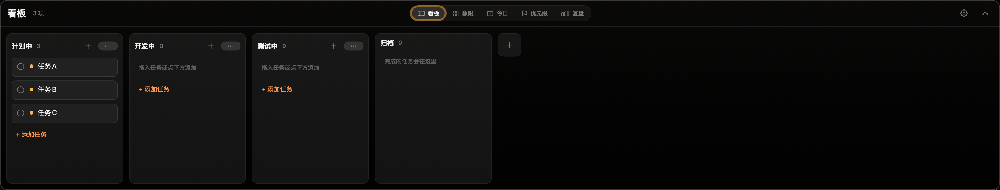

# WorkPanel

键盘优先的 macOS 任务面板。一行输入捕获待办,再用最合适的视角去看它 —— 看板、四象限、今日承诺、优先级或复盘。

<p align="center">
  
</p>

<p align="center">
  <a href="README.md">English</a>
</p>

## 功能

### 5 种看板透镜

同一批任务,5 种看法。在悬浮看板顶部的 tab 栏切换透镜。

| 透镜 | 说明 |
|------|------|
| **看板** (Kanban) | 自定义列 + 跨列拖拽;卡片显示优先级、截止时间、标签 |
| **象限** (Matrix) | 艾森豪威尔「紧急 × 重要」四象限 —— 重要 = 优先级 ≥ 中,紧急 = 截止时间在 48 小时内(或手动覆盖) |
| **今日** (Today) | 当天的「今日承诺」—— 主动挑出今天真正要推进的任务,与全部待办分开 |
| **优先级** (Priority) | 按 高 / 中 / 低 分组的平铺列表 |
| **复盘** (Review) | 已完成任务回顾,用于收尾一天 |

### 一行快速捕获

用快捷键唤出捕获面板,一行把任务写完。解析器会从纯文本里抽出结构化字段:

| 记号 | 含义 | 示例 |
|------|------|------|
| `#标签` | 标签 | `#工作` `#家庭` |
| `!高` `!中` `!低` / `!1` `!2` `!3` | 优先级 | `!高` |
| `!紧急` `!不紧急` | 紧急度覆盖 | `!紧急` |
| 相对日 | 截止日期 | `今天` `明天` `后天` `大后天` |
| 星期 | 下一个该星期几 | `周三` `下周五` |
| 重复 | 重复规则 | `每天` `每周三` `每月` `工作日` |
| 时间 | 截止时间 | `18:30`(只给了日期不给时间时默认 18:00) |

剩下的文字就是标题。例如:`写周报 明天 18:00 !高 #工作` → 一条标题为「写周报」、明天 18:00 截止、高优先级、带 `工作` 标签的任务。

### 亮点

- **悬浮面板** —— 捕获面板与看板都是不抢焦点的 `NSPanel` 悬浮层,覆盖在当前 App 之上而不夺走焦点。`ESC` 关闭。
- **全局快捷键** —— 用自定义快捷键切换捕获面板和看板(在 设置 → 快捷键 中配置,默认不设),由 [KeyboardShortcuts](https://github.com/sindresorhus/KeyboardShortcuts) 驱动。
- **菜单栏入口** —— 菜单栏的清单图标弹出完整任务列表。
- **内嵌 MCP 服务** —— 一个 localhost HTTP 服务,让外部 AI 助手(Claude Code / Claude Desktop)读写你的任务:`list_tasks`、`get_task`、`list_columns`、`create_task`、`update_task`。绑定 `127.0.0.1` 并用 Bearer token 保护。由于 App 是 SwiftData 的唯一写入方,助手的改动会实时反映到 UI。
- **提醒** —— 截止时间通知,提前量可配置,可选提示音。
- **重复与稍后处理** —— 每天 / 工作日 / 每周 / 每月重复,以及稍后提醒(snooze)。
- **暖黑设计** —— 克制的暗色工具风(见 `docs/design/`)。

## 技术栈

- **Swift 6** + **SwiftUI** —— 原生 macOS App
- **SwiftData** —— 单文件持久化(`~/Library/Application Support/WorkPanel/WorkPanel.store`)
- **AppKit** —— 自定义不抢焦点的 `NSPanel` 悬浮窗、多屏定位、点击穿透
- **MenuBarExtra** —— 菜单栏列表入口
- **UserNotifications** —— 截止时间提醒
- **Network.framework** —— 手写的内嵌 MCP HTTP 服务(无外部网络依赖)
- **KeyboardShortcuts** —— 用户可自定义的全局快捷键

## 项目结构

```
WorkPanel/
├── WorkPanelApp.swift     # 入口、MenuBarExtra、AppDelegate、共享 ModelContainer
├── Models/                # SwiftData 模型(TodoTask、BoardColumn、DayPlan、Priority、BoardViewMode)
├── Store/                 # 存储与查询(TodoStore、BoardStore、PlanStore、TaskFilter、AppSettings)
├── UI/                    # 视图:面板、看板、5 个透镜视图、任务编辑器、Markdown、暖黑主题
├── Parsing/               # 一行捕获解析(InputParser、CaptureDraft)
├── Notifications/         # ReminderScheduler
├── System/                # HotkeyManager、LaunchAtLogin
└── MCP/                   # 内嵌 MCP 服务(HTTPMessage、JSONValue、TaskDTO、MCPToolHandlers)
```

## 构建

1. 用 Xcode 打开 `WorkPanel.xcodeproj`
2. 选择 `WorkPanel` scheme
3. Build & Run(需要 macOS 26+)

打包可分发的 `.dmg`(ad-hoc 签名):

```bash
./build.sh
```

> **注意:** 若首次启动被 macOS 拦截,移除 quarantine 属性:
>
> ```bash
> sudo xattr -d com.apple.quarantine /Applications/WorkPanel.app
> ```

## 致谢

- [**KeyboardShortcuts**](https://github.com/sindresorhus/KeyboardShortcuts) —— 用户可自定义的全局快捷键
- [**NemoNotch**](https://github.com/GaoZimeng0425/NemoNotch) —— 姊妹项目;共享暖黑设计语言与悬浮面板模式

## 许可证

MIT
